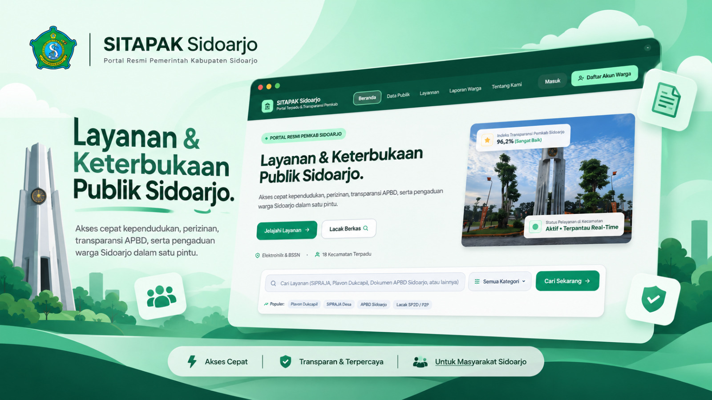

<div align="center">
  

  # SITAPAK Sidoarjo
  ### Sistem Informasi Terpadu Administrasi Pelayanan & Aspirasi Publik

  [](https://nodejs.org/)
  [](https://nestjs.com/)
  [](https://react.dev/)
  [](https://tailwindcss.com/)
  [](https://vitejs.dev/)
  [](https://github.com/advisories)
  [](https://lapeace.founduslab.my.id)

  <p align="center">
    Portal Terpadu dan Keterbukaan Publik Kabupaten Sidoarjo. Mengintegrasikan layanan administrasi kependudukan (Plavon Dukcapil), perizinan usaha (SIPRAJA / NIB / SKU), transparansi real-time APBD, kanal aspirasi warga terpadu 112/SP4N-LAPOR, serta asisten cerdas berbasis Google Gemini AI.
  </p>
</div>

---

## 📌 Daftar Isi
- [Tentang SITAPAK](#-tentang-sitapak)
- [Fitur Utama](#-fitur-utama)
- [Arsitektur & Security Hardening](#-arsitektur--security-hardening)
- [Teknologi yang Digunakan](#-teknologi-yang-digunakan)
- [Panduan Instalasi & Menjalankan Lokal](#-panduan-instalasi--menjalankan-lokal)
- [Pengujian & Verifikasi](#-pengujian--verifikasi)
- [Struktur Direktori](#-struktur-direktori)
- [Konfigurasi Produksi](#-konfigurasi-produksi)
- [Kontribusi & Lisensi](#-kontribusi--lisensi)

---

## 🏛 Tentang SITAPAK

**SITAPAK (Sistem Informasi Terpadu Administrasi Pelayanan & Aspirasi Publik)** dirancang untuk memodernisasi tata kelola pelayanan publik Kabupaten Sidoarjo. Platform ini menghadirkan pengalaman layanan digital yang inklusif, cepat, transparan, dan terdesentralisasi bagi warga dari 18 kecamatan dan 349 desa/kelurahan di Sidoarjo.

Dengan prinsip *Zero-Trust Security* dan kepatuhan penuh terhadap standar regulasi data pribadi (UU PDP No. 27/2022), SITAPAK menjamin privasi kependudukan serta integritas pengaduan publik tanpa celah manipulasi.

---

## 🚀 Fitur Utama

### 1. 🪪 Pelayanan Administrasi & Perizinan Terpadu
- **KTP Elektronik & Plavon Dukcapil**: Pengurusan permohonan baru, penggantian KTP rusak/hilang, dan pembaruan dokumen keluarga.
- **Surat Keterangan Usaha (SKU)**: Fasilitasi legalitas bagi pelaku UMKM tingkat kelurahan/kecamatan.
- **Nomor Induk Berusaha (NIB - OSS)**: Panduan terintegrasi penerbitan legalitas usaha berstandar nasional.
- **Pendaftaran DTKS & Bansos**: Verifikasi kelayakan bantuan sosial terintegrasi Dinas Sosial.
- **Rujukan Faskes BPJS**: Informasi dan integrasi faskes primer/rujukan RSUD Kabupaten Sidoarjo.

### 2. 📢 Kanal Pengaduan Warga (LAPOR Sidoarjo)
- **Pelaporan Aspirasi & Keluhan**: Pengaduan jalan berlubang, lampu penerangan, banjir, sampah, dan ketertiban umum.
- **High-Entropy Ticket IDs**: Format kode tiket ber-entropi tinggi (contoh: `LAPOR-2026-A1B2C3`) yang mencegah serangan enumerasi (*anti-IDOR*).
- **Timeline 4 Tahap Terverifikasi**: Tracking status laporan secara transparan (Menunggu Verifikasi ➔ Diteruskan ke OPD ➔ Penanganan Lapangan ➔ Selesai).
- **SLA Responsif 3x24 Jam**: Penugasan otomatis ke OPD teknis terkait.

### 3. 📊 Transparansi Data Publik & APBD Real-Time
- **Dashboard APBD Interaktif**: Visualisasi alokasi pendapatan dan belanja daerah Sidoarjo berdasarkan sektor (Infrastruktur, Pendidikan, Kesehatan, dll).
- **Tabel Pagu vs Realisasi**: Informasi anggaran yang terbuka untuk publik guna mendorong akuntabilitas pemda.
- **Statistik Demografi & Layanan**: Pemetaan distribusi laporan per kecamatan dan rekapitulasi penyelesaian.

### 4. 🤖 Asisten Virtual Cerdas (Google Gemini AI)
- Chatbot interaktif untuk konsultasi persyaratan berkas, alur birokrasi, dan bantuan darurat 112 secara instan 24/7.

### 5. 🛡️ Portal Administrator & Operator OPD
- **Verifikasi Laporan & SLA Tracker**: Dashboard khusus operator dinas untuk menindaklanjuti aduan.
- **Manajemen Akun Warga**: Validasi status verifikasi dan peran pengguna.
- **Immutable Audit Trail**: Log aktivitas audit tamper-evident untuk kepatuhan tata kelola pemerintahan.

---

## 🔒 Arsitektur & Security Hardening

SITAPAK telah melalui audit keamanan komprehensif dan remediasi ketat:

| Komponen Keamanan | Implementasi & Standar |
| :--- | :--- |
| **Proteksi Brute-Force** | Nginx IP-level rate limiting (`5r/m` pada endpoint autentikasi, `20r/s` pada endpoint API umum) dengan respons `HTTP 429 Too Many Requests`. |
| **Kriptografi Kata Sandi** | PBKDF2 dengan digest **SHA-512**, 10.000 iterasi, dynamic salt 16-byte kriptografis. Seluruh hardcoded credentials & demo backdoor telah dihapus total. |
| **Token & Sesi** | JWT bertanda tangan kriptografis dengan validasi secret kuat saat inisialisasi modul. |
| **Kepatuhan UU PDP (Data Sensitif)** | Dukungan enkripsi kolom **AES-256-GCM** dengan *blind indexing* HMAC-SHA256 (`nik_hash`) untuk pencarian tanpa membocorkan plaintext NIK/Telepon/Alamat. |
| **Sanitasi & Validasi Input** | DTO Structural Validation Pipe, strip HTML/JavaScript tag (*Anti-XSS*), dan escaping karakter wildcard SQL LIKE (`%`, `_`). |
| **Isolasi Jaringan** | Backend NestJS diikat ketat pada loopback `127.0.0.1:3001` (hanya dapat diakses melalui reverse-proxy Nginx resmi). |
| **Audit Dependensi** | **0 Vulnerability** pada `npm audit` (paket dev rentan dibersihkan & dipatch). |

---

## 🛠 Teknologi yang Digunakan

- **Backend**: [NestJS 12](https://nestjs.com/) (Modular Architecture, Guards, Interceptors, Pipes)
- **Database**: [SQLite 3](https://sqlite.org/) via native `node:sqlite` dengan mode high-concurrency **WAL (Write-Ahead Logging)**
- **Cache**: In-Memory TTL Cache Service untuk akselerasi query frekuensi tinggi
- **Frontend**: [React 19](https://react.dev/), [TypeScript](https://www.typescriptlang.org/), [Vite 8](https://vitejs.dev/)
- **Styling**: [Tailwind CSS v4](https://tailwindcss.com/), [Motion](https://motion.dev/), [Lucide React](https://lucide.dev/)
- **AI Integration**: [@google/genai SDK](https://www.npmjs.com/package/@google/genai) (Gemini Models)
- **Testing**: [Vitest](https://vitest.dev/) (Unit, Integration, & Security Test Suite)
- **Web Server / Gateway**: [Nginx](https://nginx.org/) Reverse Proxy + Certbot SSL Let's Encrypt

---

## 💻 Panduan Instalasi & Menjalankan Lokal

### 1. Prasyarat
- **Node.js** `>= 22.0.0`
- **npm** `>= 10.0.0`

### 2. Kloning Repositori & Instalasi
```bash
git clone https://github.com/jukijek/lapeace.git
cd lapeace
npm install
```

### 3. Konfigurasi Environment
Salin template konfigurasi `.env.example` ke `.env`:
```bash
cp .env.example .env
```
Sesuaikan variabel environment utama:
```env
PORT=3001
NODE_ENV=development
SITAPAK_JWT_SECRET="kunci-rahasia-jwt-minimal-32-karakter-kriptografis"
SITAPAK_PII_ENCRYPTION_KEY="64-karakter-hex-kunci-aes-256-gcm"
GEMINI_API_KEY="api-key-gemini-anda"
```

### 4. Inisialisasi Database
Jalankan sinkronisasi skema SQLite dan data awal:
```bash
node scripts/sync-database.mjs
```

### 5. Menjalankan Aplikasi
- **Jalankan Frontend (Vite)**:
  ```bash
  npm run dev
  # Aplikasi terbuka di http://localhost:3000
  ```
- **Jalankan Backend (NestJS)**:
  ```bash
  npm run start:backend:dev
  # API berjalan di http://localhost:3001/api
  ```

---

## 🧪 Pengujian & Verifikasi

Proyek dilengkapi dengan test suite otomatis mencakup pengujian fungsionalitas, RBAC, dan ketahanan keamanan:

```bash
# Menjalankan seluruh test suite (Vitest)
npm test

# Menjalankan type-checking TypeScript
npm run lint

# Memeriksa kerentanan paket dependensi
npm audit

# Melakukan kompilasi produksi
npm run build          # Frontend (Vite)
npm run build:backend  # Backend (NestJS)
```

---

## 📁 Struktur Direktori

```text
lapeace/
├── database/               # Skema SQLite (schema.sql), seed data, dan sitapak.db
├── docs/                   # Dokumentasi, aset thumbnail, dan materi arsitektur
│   └── thumbnail.jpeg      # Banner resmi SITAPAK Sidoarjo
├── nginx/                  # Konfigurasi reverse proxy dan rate limiting Nginx
├── scripts/                # Script otomasi deployment dan sinkronisasi database
├── src/
│   ├── auth/               # Modul autentikasi, JWT strategy, dan RBAC guards
│   ├── common/             # CryptoService, Sanitizer, DTO validator, & Cache
│   ├── components/         # Komponen UI modular React (Navbar, Footer, Modal)
│   ├── database/           # DatabaseService & transaksi SQLite WAL
│   ├── pages/              # Halaman layanan publik (KTP, SKU, NIB, Laporan, Admin)
│   ├── types/              # Type definitions TypeScript
│   ├── app.controller.ts   # REST API endpoint handler
│   ├── app.module.ts       # Root module NestJS
│   ├── App.tsx             # Root component React & router
│   └── main.ts             # Entrypoint server backend NestJS
├── package.json            # Daftar dependensi dan script npm
└── README.md               # Dokumentasi utama repositori
```

---

## 🌐 Konfigurasi Produksi

Aplikasi saat ini di-deploy pada VPS Ubuntu dengan konfigurasi:
- **Reverse Proxy**: Nginx dengan terminasi SSL (HTTPS) dan HTTP/2.
- **Process Manager**: PM2 (`lapeace-api` menjalankan backend NestJS di localhost `127.0.0.1:3001`).
- **Static Assets**: Frontend di-build melalui Vite dan disajikan oleh Nginx dengan HTTP caching optimal.
- **Domain Publik**: [https://lapeace.founduslab.my.id](https://lapeace.founduslab.my.id)

---

## 📄 Lisensi & Hak Cipta

Dikembangkan untuk inisiatif digitalisasi dan transparansi pelayanan publik **Pemerintah Kabupaten Sidoarjo**.  
Hak Cipta &copy; 2026. All rights reserved.
